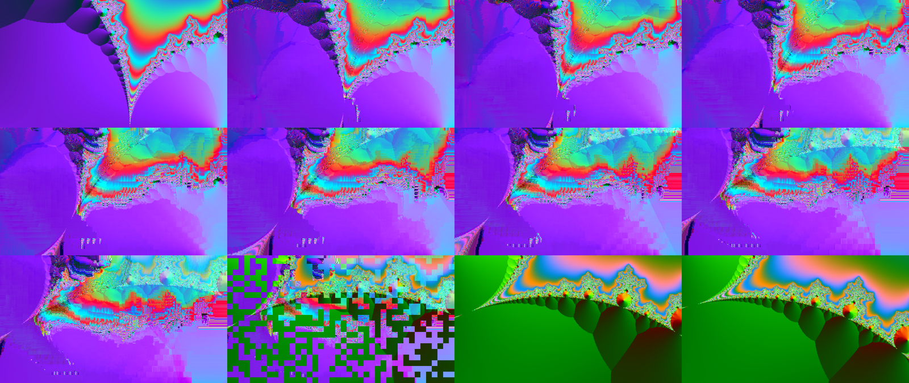
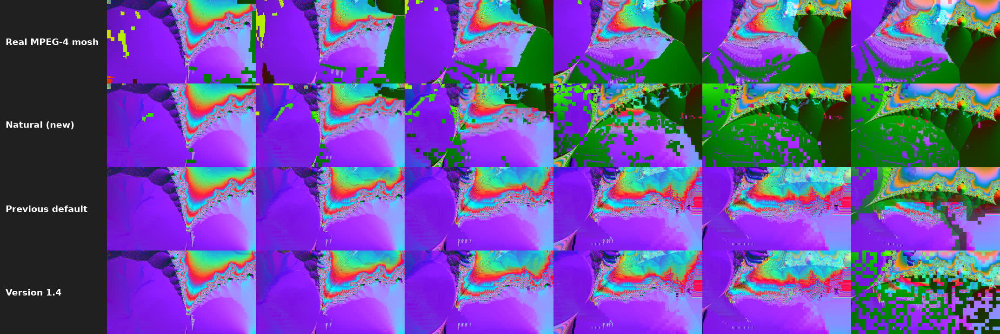
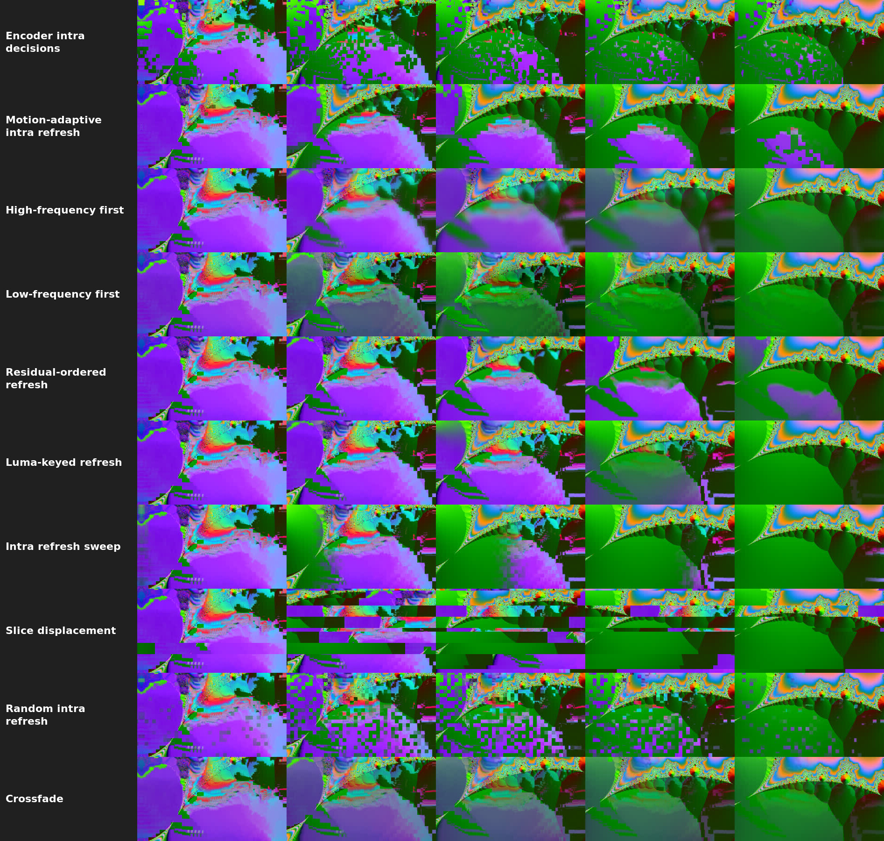

# OFX Datamosh

An OpenFX filter that fakes a **datamosh** across a cut, without touching the
video stream. Drop it on a clip that contains a cut (in DaVinci Resolve: a
compound clip made of two clips), and the frames after the cut melt the way a
video with a deleted keyframe does.



Made for DaVinci Resolve, and works in other OpenFX hosts that let a filter
read neighbouring frames, see [Hosts](#hosts).

## What it does

Real datamosh is a decoder applying P-frame motion vectors and residuals to
the wrong reference picture because the I-frame is gone. The plugin does the
same thing in software, per frame:

1. Finds the cut (the frame where a keyframe would have been), either
   automatically by the jump between consecutive frames or from a frame
   number you give.
2. Takes the last frame before the cut as the reference picture.
3. Estimates block motion between consecutive frames of the new shot the way
   an encoder does: hierarchical block matching refined to half a pixel,
   median-smoothed vector field, textureless blocks inherit their
   neighbours' vector.
4. Makes the encoder's intra decision for every block: where predicting a
   block of the new shot costs more than coding it from scratch, the block
   is coded intra and shows the new shot as it is. This starts on the first
   frame after the cut, so the new shot replaces the old one bit by bit,
   just as in a real stream with a deleted keyframe.
5. Drags the reference (and every fresh block) along the vectors with
   interpolation and adds each step's prediction residual, which carries
   the new shot's changes in. Optionally decodes every P-frame several times
   (duplicated P-frames, the "bloom").
6. Heals the stream by the end of the mosh: by default the way a real one
   heals (more and more intra blocks, fresh regions growing), or with one
   of the stylised recovery modes.

The default look was tuned against a real MPEG-4 ASP (Xvid-class) stream of
the same clips with the keyframe at the cut deleted:



*Frames 2, 7, 12, 17, 22 and 27 after the cut, 30-frame mosh.*

## Install

**One command** (downloads the latest release, checks its SHA-256, installs it):

```sh
# Linux / macOS (asks for your password through sudo)
curl -fsSL https://raw.githubusercontent.com/Woysful/ofx-datamosh/main/install.sh | sh
```

```powershell
# Windows, in PowerShell started as Administrator
irm https://raw.githubusercontent.com/Woysful/ofx-datamosh/main/install.ps1 | iex
```

Then restart DaVinci Resolve. The latest release currently has archives for
Linux x86_64 and Windows x64; on macOS build from source (see below).

**Installer scripts.** `install.sh` (Linux/macOS) and `install.ps1` (Windows)
also ship in the repository and in every release archive. In a terminal they
ask where to take the plugin from:

```
Datamosh OFX installer (linux, Linux-x86-64)
  1) local build:    build-release/linux/Datamosh.ofx.bundle (2026-11-04 22:03)
  2) latest release: v1.4.0 from github.com/Woysful/ofx-datamosh
Choose 1 or 2, q to quit [1]:
```

* The local build is the newest one for the current OS from the unpacked
  archive next to the script, `build-release/`, `build/` or the archives in
  `dist/`. Bundles built for another OS are never picked.
* The release download is checked against the SHA-256 GitHub publishes for
  the file (or a `SHA256SUMS` file in the release) and refused on mismatch.
* Without a terminal (called from another script) they use the local build,
  or download the release when there is none.
* `--local` / `--download` (`-Local` / `-Download`) skip the question, a path
  to a bundle or zip installs exactly that, `--dest DIR` (`-Dest DIR`)
  changes the target directory, `--uninstall` (`-Uninstall`) removes the
  plugin (see [Uninstall](#uninstall)). Help: `./install.sh --help`,
  `Get-Help .\install.ps1 -Detailed`.
* `install.sh` uses sudo only for the copy step when the target directory
  needs it. `install.ps1` must run as Administrator.

**Manual install.** Unpack the archive for your OS from the
[latest release](../../releases/latest) and copy the whole
`Datamosh.ofx.bundle` folder into the system OpenFX plugin directory, then
restart the host.

| OS | Plugin directory |
|---|---|
| Linux | `/usr/OFX/Plugins/` |
| Windows | `C:\Program Files\Common Files\OFX\Plugins\` |
| macOS | `/Library/OFX/Plugins/` |

Create the directory if it does not exist. Copying needs administrator
rights on all three systems.

**Linux**

```sh
sudo mkdir -p /usr/OFX/Plugins
sudo cp -r Datamosh.ofx.bundle /usr/OFX/Plugins/
```

**Windows** (PowerShell as Administrator)

```powershell
New-Item -ItemType Directory -Force "C:\Program Files\Common Files\OFX\Plugins" | Out-Null
Copy-Item -Recurse -Force .\Datamosh.ofx.bundle "C:\Program Files\Common Files\OFX\Plugins\"
```

**macOS**

```sh
sudo mkdir -p /Library/OFX/Plugins
sudo cp -R Datamosh.ofx.bundle /Library/OFX/Plugins/
# the binary is not notarised; clear the quarantine flag so Resolve may load it
sudo xattr -dr com.apple.quarantine /Library/OFX/Plugins/Datamosh.ofx.bundle
```
## Uninstall

The installers remove the plugin with `--uninstall` (`-Uninstall` on
Windows). Only `Datamosh.ofx.bundle` and the bundle of the old transition
version (`DatamoshTransition.ofx.bundle`) are deleted; other plugins in the
same directory are left alone. If you installed into a custom directory, pass
the same `--dest DIR` / `-Dest DIR`.

```sh
# Linux / macOS, from the repository or an unpacked release archive
./install.sh --uninstall
# without a local copy of the script
curl -fsSL https://raw.githubusercontent.com/Woysful/ofx-datamosh/main/install.sh | sh -s -- --uninstall
```

```powershell
# Windows, in PowerShell started as Administrator
.\install.ps1 -Uninstall
# without a local copy of the script
& ([scriptblock]::Create((irm https://raw.githubusercontent.com/Woysful/ofx-datamosh/main/install.ps1))) -Uninstall
```

Or delete the bundle by hand:

| OS | Command |
|---|---|
| Linux | `sudo rm -rf /usr/OFX/Plugins/Datamosh.ofx.bundle` |
| macOS | `sudo rm -rf /Library/OFX/Plugins/Datamosh.ofx.bundle` |
| Windows (Administrator) | `Remove-Item -Recurse -Force "C:\Program Files\Common Files\OFX\Plugins\Datamosh.ofx.bundle"` |

Restart DaVinci Resolve afterwards.

## Hosts

The plugin is a plain OpenFX 1.4 filter (Filter context, RGBA or RGB, 8-bit,
16-bit or float, CPU rendering) with no host-specific code. It needs one
thing from the host: **temporal clip access**, i.e. a filter may fetch frames
other than the one being rendered. A host that reports it does not support
this gets a clean "missing host feature" error instead of a broken effect.

| Host | Status |
|---|---|
| DaVinci Resolve (Linux, Windows, macOS) | The main target, used in practice. |
| Natron 2.5 (Linux) | Tested headless (Read > Datamosh > Write) with both styles, several recovery modes, a manual cut and the motion-vector view: the same frames as the reference test host, up to 8-bit rounding. Natron honours the "prefers sequential render" hint, so each frame costs one motion step. |
| Nuke, Fusion Studio, Flame, Baselight, Vegas, HitFilm and other OpenFX hosts | Not tested. Should work when the host gives filters temporal access; please open an issue if it does not. |

Things that differ between hosts and are handled:

* Images whose bounds differ from the output's (padding, a different
  origin, negative row strides) are mapped onto the output's pixel grid.
* Proxy / draft renders (render scale below 1): Block Size and Search Range
  are scaled with the picture, so a proxy looks like a smaller copy of the
  full-resolution result rather than a chunkier one. It is still an
  approximation; final renders at full resolution are exact.
* Hosts that render several frames at once, out of order: the caches are
  shared safely and give the same result as playing in order, only slower.

The randomness in Encoder intra decisions is seeded by the absolute frame
number the host passes in, so the same clip placed at another time on a
timeline can show a slightly different pattern of random intra blocks.

## Using it in DaVinci Resolve

1. Put the two clips next to each other on the timeline (a plain cut).
2. Select both, right-click, **New Compound Clip**.
3. Effects Library > OpenFX > Filters > **Datamosh**, drop it on the
   compound clip.
4. **Cut: Auto (scene-change detection)** finds the cut by the jump between frames. Set
   **Mosh Length** (frames after the cut) and tune the look.

Why a compound clip: the filter needs to see both sides of the cut as one
clip. A compound clip also works with several cuts inside; every cut gets
moshed.

Why not a transition: Resolve does not give OpenFX transitions access to
neighbouring frames, and a datamosh is nothing but neighbouring frames.

### Performance

The first frame after the cut is cheap; frame *k* of the mosh needs the
motion of *k* frame pairs. The plugin caches the previous frame's result, so
playing or rendering forward costs one motion step per frame. Scrubbing
backwards or jumping into the middle of a mosh rebuilds the chain from the
cut (bounded by **Max Motion Steps**). Each source frame is fetched from the
host once per render and the frame before it is kept from the previous
render, so in-order playback asks the host for one new frame per frame.
Tips if it is still slow:

* Block Size 32 is about 4x faster than 16 and looks chunkier, often better.
* Lower Max Motion Steps (24) to bound the worst case when scrubbing.
* Render the clip in place (right-click > Render in Place) once you like it.

## Parameters

The parameters are split into groups in the inspector. Parameters that do
nothing with the current settings are greyed out (Cut Frame in Auto mode,
Dark Areas First outside Luma-keyed refresh, and so on).

The menu entries use codec terms. Earlier versions used plainer names; the
stored values did not change, so old projects open with the same settings.

**Cut Detection**

| Parameter | Default | Meaning |
|---|---|---|
| Cut | Auto (scene-change detection) | Auto looks back up to Mosh Length frames for a hard cut; Manual uses Cut Frame. |
| Cut Frame | 0 | Manual mode: first frame of the new shot, in the clip's own frame numbers (Diagnostics shows `T`). |
| Cut Threshold | 0.12 | Auto mode: frame-to-frame difference that counts as a cut. |

**Mosh**

| Parameter | Default | Meaning |
|---|---|---|
| Mosh Style | Natural (intra decisions, half-pel) | Natural: per-macroblock intra/inter decisions and half-pel motion compensation, so the new shot replaces the old picture from the first frame after the cut, as in a real stream. Classic (full-pel P-blocks): the old picture is smeared on its own until recovery starts (the behaviour before Natural existed). See below. |
| Mosh Length | 30 | Frames after the cut the mosh lasts, recovery included. |
| Residual Strength | 1.0 | 0 = pure smear of the old frame, 1 = codec-accurate, >1 overdrive. |
| New Data Rate | 0.6 | How readily blocks of the new shot are coded intra (fresh) instead of predicted, from the first frame after the cut. 0 = never, about 0.5 behaves like Xvid, higher replaces the old picture faster. |
| Bloom (P-frame Repeat) | 1 | Decode each P-frame N times. 2-4 gives the classic melting, over-saturated look. |
| Motion Scale | 1.0 | Multiplies vectors. >1 exaggerates, <0 inverts. |
| Clamp Levels | on | Keep RGB in 0..1 like an 8-bit decoder. |

**Motion Estimation**

| Parameter | Default | Meaning |
|---|---|---|
| Block Size | 16x16 | Macroblock size in px. Bigger = chunkier and faster. |
| Search Range | 48 | Max motion per step, px. Raise for very fast pans. |
| Half-pixel Motion | on | Half-pixel vectors with interpolation, like MPEG-4 and H.264; the smear softens as it travels. |
| Intra Threshold | 0.35 | Extra, absolute intra rule: blocks predicted worse than this always show the new picture. 1 = off. |
| Smooth Vectors | on | Median filter on the vector field. |
| Fill Flat Areas | on | Textureless blocks take their neighbours' motion so flat regions flow too. |

**Recovery**

| Parameter | Default | Meaning |
|---|---|---|
| Recovery | Encoder intra decisions | How the real picture comes back, see below. |
| Recovery Start | 0.8 | Fraction of the mosh at which the real picture starts to return. Not used by Encoder intra decisions, which heals over the whole mosh. |
| Recovery Curve | Linear | Pace of the recovery: Linear, Smooth (slow-fast-slow), Ease in (slow start), Ease out (slow end). |
| Softness | 0.5 | How gradual the recovery is; what exactly it softens depends on the mode, see below. |
| Dark Areas First | off | Luma-keyed refresh only: reveal dark areas first. |
| Direction | Left to right | Intra refresh sweep and Slice displacement only: where the new shot comes in from (left, right, top, bottom, from the centre, to the centre). |
| Seed | 0 | Random refresh order, the ragged sweep edge, the slices, and the random intra blocks of Encoder intra decisions. |

**Performance & Debug**

| Parameter | Default | Meaning |
|---|---|---|
| Max Motion Steps | 48 | Cap on frame pairs analysed per frame when the cache is cold. |
| View | Result | "Motion vectors" shows the field used for the frame (x -> red, y -> green, intra = white). "Diagnostics" overlays numbers. |

### Recovery modes



*Frames 14, 18, 21, 24 and 27 of a 30-frame mosh, Recovery Start 0.4
(Encoder intra decisions ignores it), Softness 0.5, other settings at their
defaults.*

| Mode (earlier name) | What happens | Softness controls |
|---|---|---|
| Encoder intra decisions (Natural) | The stream heals the way a real one does, over the whole mosh from the cut on: the encoder codes more and more blocks intra, regions that already show the new shot grow outwards, and a few blocks in static areas are refreshed at random. Whatever is still stale fades in over the last 15%. Recovery Start is not used; Recovery Curve sets the pace. | - |
| Motion-adaptive intra refresh (Motion refresh) | The stream recovers inside the mosh, like an intra-refresh encoder. Regions where the new shot moves or changes come back first, whole areas at a time; static areas stay moshed longest. Refreshed blocks keep being decoded as P-blocks, so the smear around them keeps flowing in until it washes out. | how long the smear lingers in refreshed blocks |
| High-frequency first (Structure first) | The high band of the new shot (edges, texture) appears first over the smeared low band (colours) of the old one; then the low band follows. The smoothest, most "one picture turning into another" option. | how long the old colours stay after the shapes arrive |
| Low-frequency first (Colour first) | The reverse of High-frequency first: the low band (colours) of the new shot washes in under the smeared detail of the old one, then the detail follows. | how long the smeared detail stays after the colours arrive |
| Residual-ordered refresh (Settle) | Areas with the smallest residual between the mosh and the new shot settle first; the worst mismatches stay moshed longest. | width of the soft edge |
| Luma-keyed refresh (Luma reveal) | The new shot shows through its bright areas first (or dark ones, with Dark Areas First). | width of the soft edge |
| Intra refresh sweep (Wipe) | A refresh front sweeps across the frame in the chosen Direction, like periodic intra refresh, with a ragged edge one macroblock deep. | width of the soft edge |
| Slice displacement (Slice) | The frame is cut into slices 1-4 macroblocks tall (or wide, for top/bottom directions). Each slice shifts the new shot in and pushes the mosh out, on its own schedule. With the centre directions neighbouring slices shift in opposite ways. | how long each slice takes to shift in |
| Random intra refresh (Block refresh) | Macroblocks are refreshed in random order. | how long each block takes to fade in (0 = they pop) |
| Crossfade (Dissolve) | Linear blend from the moshed picture to the real one. | - |
| IDR frame (Hard cut) | The real picture as soon as recovery starts, like the next keyframe. | - |

All modes except Encoder intra decisions start at Recovery Start. New Data Rate works in
every mode, so the new shot starts coming in at the cut with any of them;
set it to 0 for a pure smear until recovery.

To get the 1.4 look back exactly: Mosh Style Classic, Recovery Random
intra refresh, Softness 0 (Residual Strength 0.6, which Classic sets).

### Mosh styles

| Style | What it does | Defaults it brings |
|---|---|---|
| Natural (intra decisions, half-pel) | Encoder-style intra/inter decisions (New Data Rate) and half-pixel motion: fresh blocks of the new shot appear from the first frame after the cut and travel with the motion, so the two shots merge gradually. | Residual Strength 1.0, Recovery Encoder intra decisions |
| Classic (full-pel P-blocks) | No intra decisions besides Intra Threshold, whole-pixel motion: the old picture is smeared by the new shot's motion and the new shot comes back during recovery. New Data Rate and Half-pixel Motion are greyed out. | Residual Strength 0.6, Recovery Motion-adaptive intra refresh |

When you switch style, Residual Strength and Recovery move to the new
style's defaults, but only if they were still at the old style's defaults;
values you changed stay. Every Recovery mode, Encoder intra decisions
included, works with both styles.

Looks to start from:

* Classic melt: Bloom 2-4, Residual 0.4-0.8, Motion Scale 1-1.5.
* Natural transition, like a real mosh: the defaults. Raise New Data Rate
  for a faster hand-over, lower it (0.3-0.4) and set Recovery Curve to
  Ease in for a long smear that heals late.
* Long, flowing transition between shots: Recovery Motion-adaptive intra
  refresh or High-frequency first, Recovery Start 0.4-0.5, Recovery Curve
  Smooth.
* Pure liquid smear of the old picture, no new colours: Residual 0,
  New Data Rate 0, Intra Threshold 1.
* Short glitch: Mosh Length 12, Recovery Start 0.6, Recovery IDR frame.
* Glitchy hand-off: Recovery Slice displacement, Softness 0.2-0.4, Block
  Size 32x32.

## Reading the Diagnostics view

Set **View** to **Diagnostics** on a frame just after the cut:

* `CUT n` is the detected cut frame; `NO CUT` means nothing within Mosh
  Length frames exceeded Cut Threshold. `SCAN MAX DIFF` is the largest jump
  seen: if it is below `THR`, lower Cut Threshold.
* `PAIR DIFF` is the difference between the two frames of the last motion
  step. Near 0.0000 means the host returned the same frame for different
  times (no temporal access), so there is no motion to work with.
* `MV` is the mean motion vector length in px. `CACHED` / `FULL` says
  whether the frame reused the previous result or rebuilt the chain.
* `Q` is the recovery progress (0..1, after the Recovery Curve), `REC` the
  recovery mode number (0-10 in menu order), `REFR` the share of blocks
  Motion-adaptive intra refresh has already refreshed (Encoder intra
  decisions: blocks that already carry the new shot), in percent. `INTRA` is the share of blocks coded intra in this frame.

## Build from source

Requirements: a C++17 compiler, CMake 3.16+, git. No other dependencies;
the OpenFX headers are fetched into `third_party/`.

**Linux / macOS**

```sh
git clone https://github.com/Woysful/ofx-datamosh.git
cd ofx-datamosh
git clone --depth 1 https://github.com/AcademySoftwareFoundation/openfx.git third_party/openfx
./build.sh --install            # build for this OS and install (asks for sudo)
```

Or with plain CMake:

```sh
cmake -S . -B build -DCMAKE_BUILD_TYPE=Release
cmake --build build -j
./install.sh --local
```

On macOS add `-DCMAKE_OSX_ARCHITECTURES="arm64;x86_64"` to the configure
step for a universal binary.

**Windows** (Visual Studio 2019/2022 with the C++ workload, or the Build Tools)

```powershell
git clone https://github.com/Woysful/ofx-datamosh.git
cd ofx-datamosh
git clone --depth 1 https://github.com/AcademySoftwareFoundation/openfx.git third_party/openfx
cmake -S . -B build -A x64
cmake --build build --config Release
# as Administrator:
.\install.ps1
```

The bundle lands in `build/Datamosh.ofx.bundle/`. On Linux the C++ runtime
is linked statically so the plugin does not clash with the libraries Resolve
ships.

**Release archives for every platform**

`build.sh` builds every platform the machine has a toolchain for and writes
`dist/ofx-datamosh-<version>-<platform>.zip` (bundle, README, LICENSE,
install scripts). The version is the git tag on the current commit, or the
version from `packaging/Info.plist`.

```sh
./build.sh --list              # which platforms can be built on this machine
./build.sh                     # all of them; the rest are skipped
./build.sh linux windows       # only these (fails if one cannot be built)
./build.sh -c -q -v v1.5.0     # clean, quiet build labelled v1.5.0
./build.sh -i linux            # build for Linux and install it
./build.sh --help              # all options
```

| Option | Meaning |
|---|---|
| `-h`, `--help` | show usage |
| `-l`, `--list` | show which platforms can be built here and how |
| `-v`, `--version VER` | version label in archive names |
| `-o`, `--output DIR` | output directory (default `dist`) |
| `-j`, `--jobs N` | parallel compile jobs |
| `-c`, `--clean` | delete `build-release/` and the output directory first |
| `-n`, `--no-zip` | only build bundles, left in `build-release/<platform>/` |
| `-q`, `--quiet` | hide compiler output, keep it in `build-release/<platform>.log` |
| `--debug` | debug build |
| `-i`, `--install` | install the build for this OS afterwards (uses sudo if needed) |
| `--install-dir DIR` | install into DIR instead of the system plugin directory (implies `--install`) |

| Platform | How it is built | What you need |
|---|---|---|
| linux | native, on Linux (x86_64 or arm64) | g++ or clang |
| windows | MinGW-w64 cross compiler on Linux/macOS, or natively in Git Bash / MSYS2 on Windows | `g++-mingw-w64-x86-64-posix` (Debian/Ubuntu), `mingw64-gcc-c++` (Fedora), `mingw-w64-gcc` (Arch), `mingw-w64` (Homebrew) |
| macos | natively on a Mac (universal arm64 + x86_64), or with [osxcross](https://github.com/tpoechtrager/osxcross) on Linux | Xcode command line tools, or osxcross `target/bin` on `PATH` |

Platforms without a toolchain are skipped with a message. `dist/SHA256SUMS`
lists the checksums of the archives. To publish, attach the files from
`dist/` to a GitHub release, e.g.
`gh release create v1.5.0 dist/*.zip dist/SHA256SUMS`. The installers find
the archive for each OS by its name ending (`-linux-x86_64.zip`,
`-windows-x64.zip`, `-macos-universal.zip`), so keep the names `build.sh`
gives them.

## Test tools

`build/mock_host` (Linux/macOS) is a tiny OpenFX host that loads the built
`.ofx`, runs describe / getFramesNeeded / isIdentity / render over a fake
clip with a cut and writes raw rgb24 frames. It is what the plugin is tested
with:

```sh
ffmpeg -f lavfi -i "smptehdbars=s=640x360:r=30:d=1.2" -pix_fmt rgb24 -f rawvideo from.rgb
ffmpeg -f lavfi -i "testsrc2=s=1280x720:r=30:d=1.2,crop=640:360:x='100+t*300':y='90+t*60'" \
       -pix_fmt rgb24 -f rawvideo to.rgb
./build/mock_host build/Datamosh.ofx.bundle/Contents/Linux-x86-64/Datamosh.ofx \
    from.rgb to.rgb 640 360 36 out.rgb
ffmpeg -f rawvideo -pix_fmt rgb24 -s 640x360 -r 30 -i out.rgb out.mp4
```

Any parameter can be set after the view argument as `name=value`, e.g.
`... out.rgb 0 recoverMode=4 recoverStart=0.4`. `MOCK_PURGE=1` drops the
plugin's cache before every frame (like scrubbing), so the output can be
compared with a normal sequential run; `MOCK_PARAMS=1` prints each
parameter's group and enabled state and exits. Other switches emulate what
real hosts do differently: `MOCK_THREADS=n` provides the multithread suite
with n threads, `MOCK_SCALE=0.5` renders at a render scale (output scaled
back up), `MOCK_PAD=n` gives source images an n-pixel border beyond the
output's bounds, `MOCK_OFFSET=n` moves every image's origin to (n, n),
`MOCK_NO_TEMPORAL=1` reports a host without temporal clip access. The host
prints the total and average time spent in render.

`build/mosh_test` runs only the algorithm core on two raw clips.

## Layout

```
src/mosh_core.h          host-independent algorithm (motion search, mosh step, recovery)
src/datamosh_plugin.cpp  OpenFX glue: describe, params, cut detection, caches, render
tools/mosh_test.cpp      offline harness for the core
tools/mock_host.cpp      minimal OpenFX host for end-to-end plugin tests
packaging/Info.plist     bundle metadata
install.sh / install.ps1 install a local build or the latest release (SHA-256 checked)
build.sh                 release archives for Linux, Windows and macOS into dist/
cmake/                   toolchain files for MinGW-w64 and osxcross cross builds
```

## License

MIT
