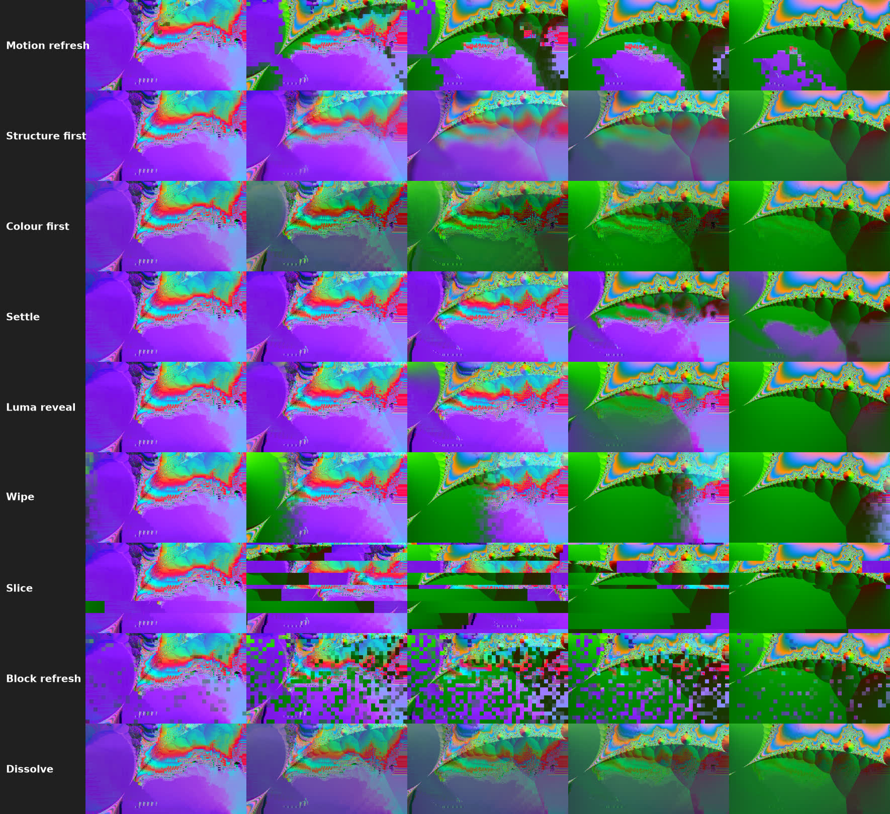

# User guide

[Back to README](../README.md)

* [Parameters](#parameters)
* [Recovery modes](#recovery-modes)
* [Mosh styles](#mosh-styles)
* [Marking cuts with keyframes](#marking-cuts-with-keyframes)
* [Presets](#presets)
* [Looks to start from](#looks-to-start-from)
* [Performance](#performance)
* [Reading the Diagnostics view](#reading-the-diagnostics-view)

## What the plugin does

Real datamosh is a decoder applying P-frame motion vectors and residuals to
the wrong reference picture because the I-frame is gone. The plugin does the
same thing in software, per frame:

1. Finds the cut (the frame where a keyframe would have been), either
   automatically by the jump between consecutive frames or from a frame
   number you give.
2. Takes the last frame before the cut as the reference picture.
3. Estimates block motion between consecutive frames of the new shot the way
   an encoder does: hierarchical block matching refined to half a pixel,
   median-smoothed vector field, textureless blocks inherit their
   neighbours' vector.
4. Makes the encoder's intra decision for every block: where predicting a
   block of the new shot costs more than coding it from scratch, the block
   is coded intra and shows the new shot as it is. This starts on the first
   frame after the cut, so the new shot replaces the old one bit by bit,
   just as in a real stream with a deleted keyframe.
5. Drags the reference (and every fresh block) along the vectors with
   interpolation and adds each step's prediction residual, which carries
   the new shot's changes in. Optionally decodes every P-frame several times
   (duplicated P-frames, the "bloom").
6. Heals the stream by the end of the mosh: by default the way a real one
   heals (more and more intra blocks, fresh regions growing), or with one
   of the stylised recovery modes.

## Parameters

The parameters are split into groups in the inspector. Parameters that do
nothing with the current settings are greyed out (Cut Frame in Auto mode,
Dark Areas First outside Luma-keyed refresh, and so on). The first two groups
are closed by default: **How to use** holds a short version of the Resolve
quick start from the README, **Presets** saves and loads your own settings
(see [Presets](#presets)).

The menu entries use codec terms. Version 1.4 had only three recovery
modes, called Block refresh, Dissolve and Hard cut; they are now Random
intra refresh, Crossfade and IDR frame. The stored values did not change, so
1.4 projects open with the same settings.

**Cut Detection**

| Parameter | Default | Meaning |
|---|---|---|
| Cut | Auto (scene-change detection) | Auto looks back up to Mosh Length frames for a hard cut; Manual uses Cut Frame; Keyframes uses the keyframes of Cut Here, see [Marking cuts with keyframes](#marking-cuts-with-keyframes). |
| Cut Frame | 0 | Manual mode: first frame of the new shot, in the clip's own frame numbers (Diagnostics shows `T`). |
| Cut Here | off | Keyframes mode: every keyframe of this parameter is a cut. || Cut Threshold | 0.12 | Auto mode: frame-to-frame difference that counts as a cut. |

**Mosh**

| Parameter | Default | Meaning |
|---|---|---|
| Mosh Style | Intra + half-pel | See [Mosh styles](#mosh-styles). |
| Mosh Length | 30 | Frames after the cut the mosh lasts, recovery included. |
| Residual Strength | 1.0 | 0 = pure smear of the old frame, 1 = codec-accurate, >1 overdrive. |
| New Data Rate | 0.6 | How readily blocks of the new shot are coded intra (fresh) instead of predicted, from the first frame after the cut. 0 = never, about 0.5 behaves like Xvid, higher replaces the old picture faster. |
| Bloom (P-frame Repeat) | 1 | Decode each P-frame N times. 2-4 gives the melting, over-saturated look. |
| Motion Scale | 1.0 | Multiplies vectors. >1 exaggerates, <0 inverts. |
| Clamp Levels | on | Keep RGB in 0..1 like an 8-bit decoder. |

**Motion Estimation**

| Parameter | Default | Meaning |
|---|---|---|
| Block Size | 16x16 | Macroblock size in px. Bigger = chunkier and faster. |
| Search Range | 48 | Max motion per step, px. Raise for very fast pans. |
| Half-pixel Motion | on | Half-pixel vectors with interpolation, like MPEG-4 and H.264; the smear softens as it travels. |
| Intra Threshold | 0.35 | Extra, absolute intra rule: blocks predicted worse than this always show the new picture. 1 = off. |
| Smooth Vectors | on | Median filter on the vector field. |
| Fill Flat Areas | on | Textureless blocks take their neighbours' motion so flat regions flow too. |

**Recovery**

| Parameter | Default | Meaning |
|---|---|---|
| Recovery | Encoder intra decisions | How the real picture comes back, see [Recovery modes](#recovery-modes). |
| Recovery Start | 0.8 | Fraction of the mosh at which the real picture starts to return. Not used by Encoder intra decisions, which heals over the whole mosh. |
| Recovery Curve | Linear | Pace of the recovery: Linear, Smooth (slow-fast-slow), Ease in (slow start), Ease out (slow end). |
| Softness | 0.5 | How gradual the recovery is; what exactly it softens depends on the mode. |
| Dark Areas First | off | Luma-keyed refresh only: reveal dark areas first. |
| Direction | Left to right | Intra refresh sweep and Slice displacement only: where the new shot comes in from (left, right, top, bottom, from the centre, to the centre). |
| Seed | 0 | Random refresh order, the ragged sweep edge, the slices, and the random intra blocks of Encoder intra decisions. |

**Performance & Debug**

| Parameter | Default | Meaning |
|---|---|---|
| Max Motion Steps | 48 | Cap on frame pairs analysed per frame when the cache is cold. |
| View | Result | "Motion vectors" shows the field used for the frame (x -> red, y -> green, intra = white). "Diagnostics" overlays numbers. |

## Recovery modes

*Frames 14, 18, 21, 24 and 27 of a 30-frame mosh, Recovery Start 0.4
(Encoder intra decisions ignores it), Softness 0.5, other settings at their
defaults.*

| Mode | What happens | Softness controls |
|---|---|---|
| Encoder intra decisions | The stream heals the way a real one does, over the whole mosh from the cut on: the encoder codes more and more blocks intra, regions that already show the new shot grow outwards, and a few blocks in static areas are refreshed at random. Whatever is still stale fades in over the last 15%. Recovery Start is not used; Recovery Curve sets the pace. | - |
| Motion-adaptive intra refresh | The stream recovers inside the mosh, like an intra-refresh encoder. Regions where the new shot moves or changes come back first, whole areas at a time; static areas stay moshed longest. Refreshed blocks keep being decoded as P-blocks, so the smear around them keeps flowing in until it washes out. | how long the smear lingers in refreshed blocks |
| High-frequency first | The high band of the new shot (edges, texture) appears first over the smeared low band (colours) of the old one; then the low band follows. The smoothest, most "one picture turning into another" option. | how long the old colours stay after the shapes arrive |
| Low-frequency first | The reverse of High-frequency first: the low band (colours) of the new shot washes in under the smeared detail of the old one, then the detail follows. | how long the smeared detail stays after the colours arrive |
| Residual-ordered refresh | Areas with the smallest residual between the mosh and the new shot settle first; the worst mismatches stay moshed longest. | width of the soft edge |
| Luma-keyed refresh | The new shot shows through its bright areas first (or dark ones, with Dark Areas First). | width of the soft edge |
| Intra refresh sweep | A refresh front sweeps across the frame in the chosen Direction, like periodic intra refresh, with a ragged edge one macroblock deep. | width of the soft edge |
| Slice displacement | The frame is cut into slices 1-4 macroblocks tall (or wide, for top/bottom directions). Each slice shifts the new shot in and pushes the mosh out, on its own schedule. With the centre directions neighbouring slices shift in opposite ways. | how long each slice takes to shift in |
| Random intra refresh (1.4: Block refresh) | Macroblocks are refreshed in random order. | how long each block takes to fade in (0 = they pop) |
| Crossfade (1.4: Dissolve) | Linear blend from the moshed picture to the real one. | - |
| IDR frame (1.4: Hard cut) | The real picture as soon as recovery starts, like the next keyframe. | - |

All modes except Encoder intra decisions start at Recovery Start. New Data
Rate works in every mode, so the new shot starts coming in at the cut with
any of them; set it to 0 for a pure smear until recovery.

To get the 1.4 look back exactly: Mosh Style P-only, full-pel, Recovery
Random intra refresh, Softness 0 (Residual Strength 0.6, which that style
sets).

## Mosh styles

| Style | What it does | Defaults it brings |
|---|---|---|
| Intra + half-pel (new shot from the cut) | Encoder-style intra/inter decisions per macroblock (New Data Rate) and half-pixel motion compensation: fresh blocks of the new shot appear from the first frame after the cut and travel with the motion, so the two shots merge gradually. | Residual Strength 1.0, Recovery Encoder intra decisions |
| P-only, full-pel (smear until recovery) | No intra decisions besides Intra Threshold, whole-pixel motion: the old picture is smeared by the new shot's motion and the new shot comes back during recovery, as in versions before 1.5. New Data Rate and Half-pixel Motion are greyed out. | Residual Strength 0.6, Recovery Motion-adaptive intra refresh |

When you switch style, Residual Strength and Recovery move to the new
style's defaults, but only if they were still at the old style's defaults;
values you changed stay. Every Recovery mode works with both styles.

## Marking cuts with keyframes

Auto finds every hard cut in the clip by itself. When you want to pick the
cuts yourself (only some of them, or a cut Auto does not see), set **Cut**
to **Keyframes (Cut Here)** and mark the cuts with keyframes of **Cut Here**:

1. Move the playhead to the first frame of the new shot.
2. Click the keyframe button next to Cut Here. The value of the checkbox
   does not matter, only where the keyframes are.
3. Repeat for every cut you want moshed.

To move a cut, drag its keyframe; to drop a cut, delete its keyframe. Only
marked cuts are moshed, any others in the clip are left alone. A keyframe
on the very first frame of the clip is ignored, because there is no old
picture before it. Diagnostics shows `KEYS n`, the number of keyframes the
plugin sees.

Some hosts do not tell plugins where keyframes are (Diagnostics then shows
`KEYS UNKNOWN`). There a cut is the frame where the value of Cut Here
changes, so toggle the checkbox at each cut instead.

## Presets

DaVinci Resolve has no way to save the settings of an OpenFX effect as a
preset, so the plugin has its own: open the **Presets** group, pick a
**Slot** (User 1 to User 4), and press **Save to Slot**. On another clip, in
any project, pick the slot and press **Load from Slot**.

A preset holds every setting except Cut Detection (that belongs to the clip)
and View. Saving replaces what the slot held before. The slots are kept in
`presets.ini` in your user settings folder, which you can copy to another
machine or edit by hand:

| OS | File |
|---|---|
| Windows | `%APPDATA%\ofx-datamosh\presets.ini` |
| macOS | `~/Library/Application Support/ofx-datamosh/presets.ini` |
| Linux | `~/.config/ofx-datamosh/presets.ini` (or `$XDG_CONFIG_HOME/ofx-datamosh/`) |

The environment variable `OFX_DATAMOSH_PRESETS` overrides the path.

Without the plugin's slots, Resolve itself can still carry settings over:
on the Edit page copy the clip, then on the target clip use **Paste
Attributes** (Alt+V) and tick Plugins; on the Color page save the node as a
still or PowerGrade.

## Looks to start from
* Melting smear: Mosh Style P-only, full-pel, Bloom 2-4, Residual 0.4-0.8,
  Motion Scale 1-1.5.
* Realistic mosh, like a broken stream: the defaults. Raise New Data Rate
  for a faster hand-over, lower it (0.3-0.4) and set Recovery Curve to
  Ease in for a long smear that heals late.
* Long, flowing transition between shots: Recovery Motion-adaptive intra
  refresh or High-frequency first, Recovery Start 0.4-0.5, Recovery Curve
  Smooth.
* Pure liquid smear of the old picture, no new colours: Residual 0,
  New Data Rate 0, Intra Threshold 1.
* Short glitch: Mosh Length 12, Recovery Start 0.6, Recovery IDR frame.
* Glitchy hand-off: Recovery Slice displacement, Softness 0.2-0.4, Block
  Size 32x32.

## Performance

The first frame after the cut is cheap; frame *k* of the mosh needs the
motion of *k* frame pairs. The plugin caches the previous frame's result, so
playing or rendering forward costs one motion step per frame. Scrubbing
backwards or jumping into the middle of a mosh rebuilds the chain from the
cut (bounded by **Max Motion Steps**). Each source frame is fetched from the
host once per render and the frame before it is kept from the previous
render, so in-order playback asks the host for one new frame per frame.
Tips if it is still slow:

* Block Size 32x32 is about 4x faster than 16x16 and looks chunkier, often
  better.
* Lower Max Motion Steps (24) to bound the worst case when scrubbing.
* In Resolve, render the clip in place (right-click > Render in Place) once
  you like it.

## Reading the Diagnostics view

Set **View** to **Diagnostics** on a frame just after the cut:

* `CUT n` is the detected cut frame; `NO CUT` means nothing within Mosh
  Length frames exceeded Cut Threshold. `SCAN MAX DIFF` is the largest jump
  seen: if it is below `THR`, lower Cut Threshold.
* `PAIR DIFF` is the difference between the two frames of the last motion
  step. Near 0.0000 means the host returned the same frame for different
  times (no temporal access), so there is no motion to work with.
* `MV` is the mean motion vector length in px. `CACHED` / `FULL` says
  whether the frame reused the previous result or rebuilt the chain.
* `Q` is the recovery progress (0..1, after the Recovery Curve), `REC` the
  recovery mode number (0-10 in menu order), `REFR` the share of blocks
  Motion-adaptive intra refresh has already refreshed (Encoder intra
  decisions: blocks that already carry the new shot), in percent. `INTRA`
  is the share of blocks coded intra in this frame.
